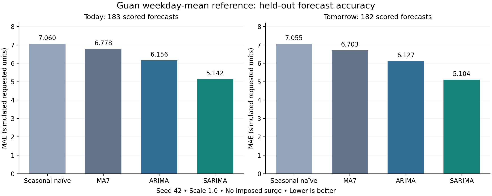

# Platelet Inventory Optimization

**A Decision-Support Framework for Blood Inventory Optimization: Forecasting and Prescriptive Analytics for an Oncology Blood Bank**

B.Tech Industrial Engineering final-year project. This repository contains the current **Guan reference synthetic experiment**: demand generation, chronological forecast evaluation, an age-structured inventory simulator, a fixed-order benchmark, and automated verification.

**Research status:** four forecasting methods and the fixed-order inventory benchmark have been evaluated for one synthetic seed. Comparing inventory policies driven by ARIMA/SARIMA forecasts remains future work. This is a simulation study; hospital forecasting accuracy and operational benefits are unvalidated.



## Quick start

Use Python **3.12**. Open a terminal in this repository's root folder.

```bash
python -m venv .venv
```

Activate the environment:

```powershell
# Windows PowerShell
.\.venv\Scripts\Activate.ps1
```

```bash
# macOS / Linux
source .venv/bin/activate
```

Then install and run:

```bash
python -m pip install -r requirements.txt
python run_project.py --output-dir local_results
python scripts/check_reproduction.py --output-dir local_results
```

The runner regenerates demand and fixed-order simulation files, searches the declared ARIMA/SARIMA configurations, evaluates forecasts, audits them, and runs the 40 existing tests. It limits numerical libraries to one thread for reproducibility. Model fitting can take several minutes. Choose a new or empty forecast output directory for each run.

On Windows, `py -3.12` can replace `python` when creating the environment. If activation is unavailable, use `.venv\Scripts\python.exe` for the subsequent commands without activating.

## Inspect the supplied results without a full model search

The verified reference outputs are already included in `results/` and `baseline/`.

```bash
python -m unittest discover -s tests -v
python verify_advanced.py --output-dir results
```

The audit replays saved forecasts and simulator callbacks; it does not repeat the entire model search. `run_project.py` is the recommended route for a complete rerun.

The saved-result audit uses the stored fitted coefficients for both independent filtering and live simulator callbacks. Fresh optimizer fits can differ slightly across CPUs and numerical libraries, even with pinned package versions and a fixed random seed. The strict reference-comparison command reports such differences; bit-for-bit or `1e-8` agreement after refitting is not guaranteed across machines. The existing forecasting tests separately compare newly fitted offline and live forecasts in the same environment.

## What the pipeline does

1. `data_synthesis.py` creates 730 days of synthetic requested platelet units using a weekday-specific Poisson distribution and seed 42, then runs the fixed-order simulator benchmark.
2. `forecast_models.py` compares seasonal naive, a trailing seven-day moving average, ARIMA and weekly SARIMA.
3. Model settings are chosen using validation today's MAE, then selected models are refitted on all development observations. Test forecasts use fixed fitted parameters with sequential state updates.
4. `verify_advanced.py` independently audits forecast records, errors, filtering and live simulator callbacks.
5. The simulator tracks remaining usable life, receives yesterday's order before today's decision, issues FEFO, records shortages, and expires/ages remaining stock.

The forecasting input is **`inputs/forecast_input_GuanReference.csv`**. Forecast `units_requested`, including unmet requests. The generator audit file contains the true mean and must not be used as forecasting features.

## Chronological evaluation

| Period | Inclusive dates | Days | Purpose |
| --- | --- | ---: | --- |
| Training | 2024-01-01 to 2025-03-31 | 456 | Fit candidate models |
| Validation | 2025-04-01 to 2025-06-30 | 91 | Select settings |
| Test | 2025-07-01 to 2025-12-30 | 183 | Evaluate frozen settings |

At the start of day t, today's demand is unknown. Horizon 1 predicts today; horizon 2 predicts tomorrow. Both use observations through yesterday. Earlier observed test requests can inform later rolling forecasts, without tuning settings on test errors. Zero-demand days are retained. Negative point predictions are consistently clipped at zero; forecasts stay continuous for accuracy evaluation.

The limited search uses **18 ARIMA** and **30 SARIMA** configurations for the single reference. Selected orders are ARIMA(2,0,2) with a constant and SARIMA(0,0,0)(1,0,1)[7] with a constant. Full settings and candidate scores are in `results/`.

## Reference forecast results

Errors are in synthetic requested platelet units; lower is better.

| Model | Today MAE | Today RMSE | Tomorrow MAE | Tomorrow RMSE |
| --- | ---: | ---: | ---: | ---: |
| Seasonal naive | 7.060 | 8.910 | 7.055 | 8.915 |
| Seven-day moving average | 6.778 | 8.304 | 6.703 | 8.312 |
| ARIMA | 6.156 | 7.571 | 6.127 | 7.543 |
| SARIMA | 5.142 | 6.329 | 5.104 | 6.284 |

SARIMA has the lowest errors among these four models for this one weekly synthetic reference. There are 183 scored today and 182 scored tomorrow forecasts per model. Boundary-crossing targets are saved but excluded from the corresponding period's accuracy.

## Fixed-order inventory benchmark

The benchmark orders **37 units/day**, computed using half-up rounding of 1.05 times the configured equal-weekday reference mean. This is an assumed benchmark, not an optimized policy or a hospital recommendation.

| Test-window measure | Result |
| --- | ---: |
| Requested / issued / unmet | 6,600 / 6,565 / 35 units |
| Fill rate | 99.47% |
| Stockout-day rate | 1.64% (3/183 days) |
| Wastage | 3.40% = 233/(65 + 6,780) |
| Mean closing stock | 80.67 units |
| Opening / closing inventory | 65 / 47 units |
| Ending outstanding orders | 37 units |
| Weighted shortage/expiry score | 408 = 5 x 35 + 233 |

These outcomes belong to **fixed ordering**, not SARIMA-driven ordering. Inventory carries across period boundaries. The weights are assumed and nonmonetary. Definitions and timing are in [the modelling contract](docs/MODELLING_CONTRACT.md).

## Repository files

| Location | Contents |
| --- | --- |
| `run_project.py` | Complete pipeline runner |
| `data_synthesis.py`, `demand.py` | Generation and fixed-order benchmark |
| `forecast_models.py`, `advanced_forecasting.py`, `forecasting.py` | Models, search, causal forecasts and error metrics |
| `simulator.py`, `policies.py`, `integration.py` | Inventory engine and policy/forecast interfaces |
| `configuration.py`, `config.json` | Shared settings and integer rounding |
| `inputs/` | Forecasting data, generator audit and weekday summaries |
| `results/` | Saved forecasts, metrics, settings, diagnostics and audit |
| `baseline/` | Fixed-order daily traces, age states, orders and metrics |
| `tests/` | 19 simulator, 15 integration and 6 forecasting tests |
| `scripts/check_reproduction.py` | Compare a fresh run with the supplied reference |
| `docs/` | Assumptions, report, source provenance, handover and checks |
| `.github/workflows/ci.yml` | Automated tests/audit; optional full reproduction |
| `Guan_Project.ipynb` | Optional notebook wrapper; requires a notebook environment separately |

`experiment.py` and several policy adapters are inherited support code. Use `run_project.py` for the current experiment. Their presence does not establish completed alternative-policy results.

## GitHub checks

The included workflow installs the pinned dependencies, runs the 40 tests and audits the supplied results on pushes and pull requests. A manual **Run workflow** option with `full_reproduction` enabled also runs the complete pipeline and compares its outputs. A workflow file is included; a successful hosted GitHub run is only established after publication and execution.

See [GITHUB_SETUP.md](GITHUB_SETUP.md) for publishing steps. No website or interactive dashboard is included in this research-code repository.

## Evidence and assumptions

Guan et al. (2017), *Big data modeling to predict platelet usage and minimize wastage in a tertiary care system*, PNAS 114(43), 11368-11373. [DOI](https://doi.org/10.1073/pnas.1714097114), [article and supplementary material](https://pmc.ncbi.nlm.nih.gov/articles/PMC5664553/).

Published weekday **transfusion means** are used as proxies to generate synthetic requested units. These are not reconstructed hospital records. The generator matches weekday means only: its Poisson variability is lower than the published weekday standard deviations. Lead time, supply variability, receipt shelf life, buffer/cost choices and initial state are project assumptions. The imposed 21-day surge is disabled. See [ASSUMPTIONS.md](docs/ASSUMPTIONS.md) and [source_reference.json](source_reference.json).

The complete reference report is [docs/Guan_Rerun_Results.md](docs/Guan_Rerun_Results.md). See [HANDOVER.md](docs/HANDOVER.md) for completed work and remaining experiments. Only one seed is evaluated; confidence intervals and operational benefits are not established.

